<div align="center">



<br/>

# Utkarsh Jain

**Backend & Systems · Linux · DevOps · Security · AI**

I build in Go, ship with Docker, and like understanding what happens under the hood.

[Projects](#projects) · [Toolbox](#toolbox) · [Now](#now) · [Connect](#connect)

<br/>


</div>


## `~/projects`

<table>
  <tr>
    <td width="50%" valign="top">
      <h3>↗ <a href="https://github.com/utkarshjain1338-hub/linkforge">LinkForge</a></h3>
      <p>A self-hosted URL shortener with a web UI, PostgreSQL persistence, and rate limiting. Nginx handles incoming traffic; Docker Compose ties the services together.</p>
      <p><code>Go</code> <code>PostgreSQL</code> <code>Docker</code> <code>Nginx</code></p>
    </td>
    <td width="50%" valign="top">
      <h3>⌁ <a href="https://github.com/utkarshjain1338-hub">Syslyzer</a></h3>
      <p>A lightweight Go API for Linux system metrics, packaged as a Docker image and published to GHCR through GitHub Actions.</p>
      <p><code>Go</code> <code>Linux</code> <code>Docker</code> <code>CI/CD</code></p>
    </td>
  </tr>
</table>


## `~/toolbox`

| Area | Tools & interests |
|:--|:--|
| **Languages** | Go · Python · Bash |
| **Systems** | Linux · Shell scripting · Networking |
| **Infrastructure** | Docker · Docker Compose · Nginx |
| **Automation** | Git · GitHub Actions · CI/CD |
| **Data** | PostgreSQL |
| **Exploring** | Defensive security · Cloud · LLMs · AI automation |


## `~/now`

```bash
$ cat current-focus.txt

→ Adding tests and deployment automation to my Go projects
→ Learning networking and defensive security fundamentals
→ Exploring Linux internals and container behavior
→ Experimenting with LLMs for practical automation
```

I learn best by building things, breaking them, reading the logs, and figuring out why they broke.


## `~/connect`

Open to collaborating on useful tools, learning from other builders, and discussing systems, infrastructure, security, or AI.

<a href="https://github.com/utkarshjain1338-hub">
  
</a>

<br/><br/>

<div align="center">


<sub><code>build → test → debug → learn → repeat</code></sub>

</div>
